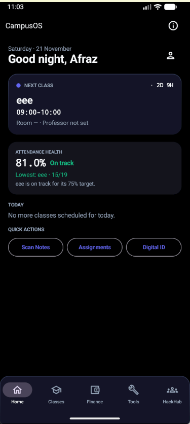
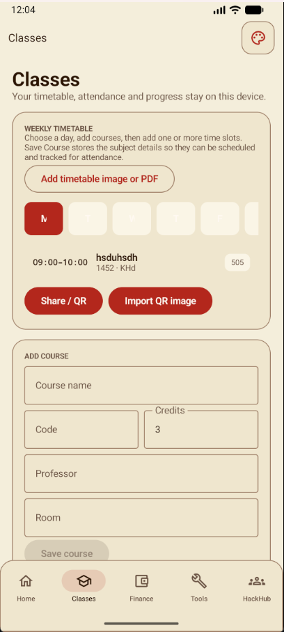
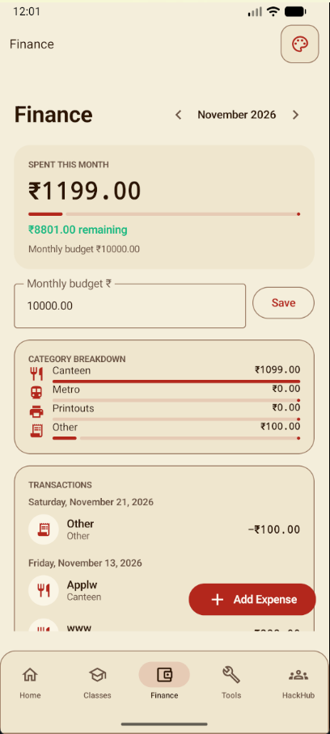
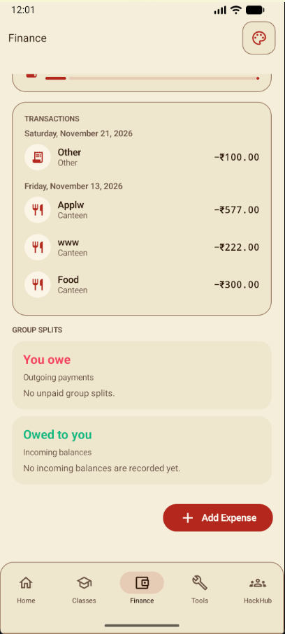
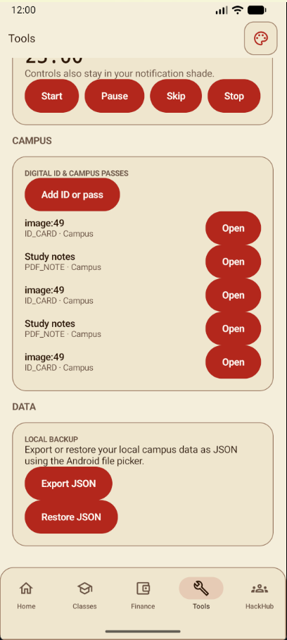
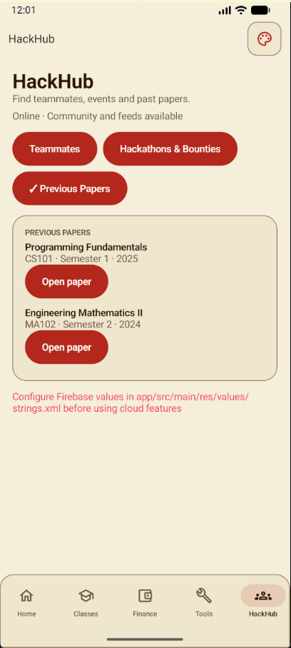

# CampusOS

**CampusOS** brings a student's daily campus tools into one offline-first Android app: a day-first dashboard, timetable and attendance tracker, finance and bill splits, study utilities, and HackHub.

<p align="center">
  <a href="https://github.com/Afraz-Dev-Pro/Afraz-CampusOS/releases/tag/V1.5A"></a>
  <a href="https://developer.android.com/"></a>
  <a href="https://kotlinlang.org/"></a>
  <a href="https://developer.android.com/jetpack/compose"></a>
</p>

> **Release:** GitHub release tag **V1.5A** ([release page](https://github.com/Afraz-Dev-Pro/Afraz-CampusOS/releases/tag/V1.5A)). Its uploaded APK is named `CampusOS.V1.8A.apk`.  
> **Source build:** `com.afraz.campusos`, Gradle `versionName` **1.1.4**, `versionCode` **6**. The source build number and the published release tag are tracked separately.

## App screenshots

Updated Android app screenshots:

<table>
  <tr>
    <th align="center">Today</th><th align="center">Classes</th><th align="center">Finance</th>
  </tr>
  <tr>
    <td align="center"></td>
    <td align="center"></td>
    <td align="center"></td>
  </tr>
  <tr>
    <th align="center">Group splits</th><th align="center">Toolkit</th><th align="center">HackHub</th>
  </tr>
  <tr>
    <td align="center"></td>
    <td align="center"></td>
    <td align="center"></td>
  </tr>
</table>

## What it does

- **Today dashboard:** upcoming class, attendance health, today's schedule, deadlines, and quick actions.
- **Classes:** weekly timetable, attendance logging and recovery guidance, assignments and exams, syllabus tracking, SGPA/CGPA tools, and previous-year papers.
- **Finance:** monthly budget, category totals, editable expenses, group bill splitting, and UPI handoff for settling a share.
- **Toolkit:** document scanning and PDFs, focus timer, digital ID and campus passes, and local JSON backup and restore.
- **HackHub:** teammate discovery, hackathons and bounties, and cached community resources. Sign-in is only prompted for actions that require an account.
- **Theme Studio:** persisted built-in themes and editable custom hex colors.

Academic records, expenses, wallet documents, and theme preferences are stored locally. HackHub's community and feed features can use network access; they do not gate the local parts of the app.

## Project map

```text
CampusOS/
├── app/src/main/
│   ├── assets/                    # Bundled HackHub feed data
│   ├── java/com/afraz/campusos/
│   │   ├── core/designsystem/     # Shared cards and tabular-number styling
│   │   ├── core/util/             # Attendance, grade, PDF, UPI, QR, and device helpers
│   │   ├── data/                  # Room entities, DAOs, database, JSON backup
│   │   ├── di/                    # Hilt database and network modules
│   │   ├── feature_academics/     # Timetable, attendance, tasks, syllabus, grade tools
│   │   ├── feature_dashboard/     # Home dashboard and About screen
│   │   ├── feature_hackhub/       # Community feeds and lazy authentication
│   │   ├── feature_toolkit/       # Finance, focus, documents, wallet, widget, tile
│   │   ├── navigation/            # Top-level destinations and app shell
│   │   └── ui/theme/              # Palette presets, Theme Studio, persistence, Compose theme
│   └── res/                       # Android resources and manifest
├── assets/screenshots/            # README app screenshots
├── gradle/libs.versions.toml      # Dependency versions
├── firestore.rules                # Firestore access rules
├── app/build.gradle.kts           # Android app ID and source version
└── gradlew / gradlew.bat           # Gradle wrappers
```

## Build

### Requirements

- JDK 17
- Android SDK 35
- Android Studio recommended

Build a debug APK:

**Windows PowerShell**

```powershell
.\gradlew.bat assembleDebug
```

**macOS or Linux**

```bash
./gradlew assembleDebug
```

The debug APK is created at `app/build/outputs/apk/debug/app-debug.apk`. A debug APK is for development; use a properly signed release build for distribution.

## Optional Firebase setup

Local academics, finance, and toolkit features work without an account. To enable Firebase community features, configure the Android app for `com.afraz.campusos`, add the Firebase configuration, set the Google sign-in values in `app/src/main/res/values/strings.xml`, and deploy `firestore.rules`.

## Privacy and permissions

- The app uses Android's document and photo pickers rather than broad storage access.
- Cloud/community actions are opt-in.
- Review [`AndroidManifest.xml`](app/src/main/AndroidManifest.xml) and [`firestore.rules`](firestore.rules) for platform and cloud access details.

## Download

See the [V1.5A GitHub release](https://github.com/Afraz-Dev-Pro/Afraz-CampusOS/releases/tag/V1.5A) for the published APK and release notes.
