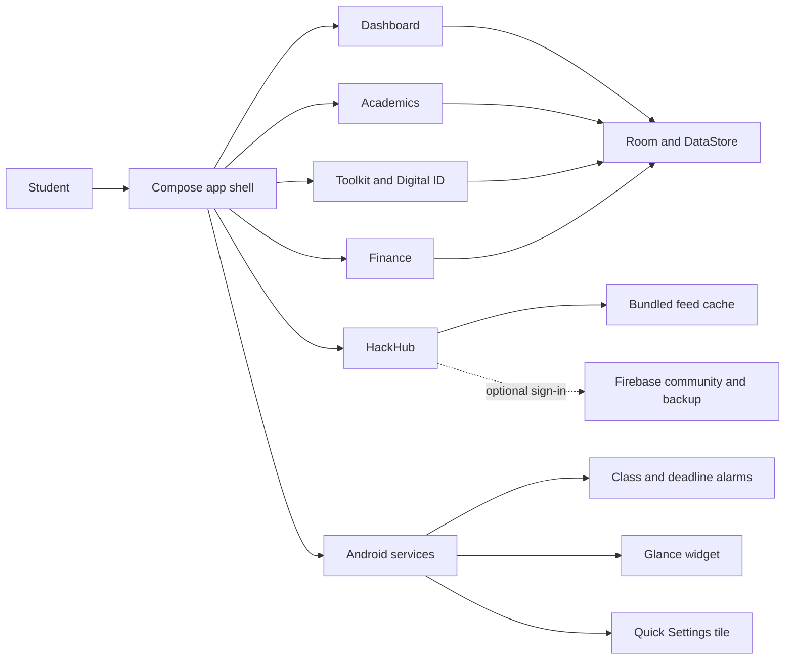

<p align="center">
  
</p>

<h1 align="center">CampusOS</h1>

<p align="center">
  <strong>Your campus life, in one calm command center.</strong><br />
  Academics, focus, money, documents, and campus connections in one Android app.
</p>

<p align="center">
  <a href="https://github.com/Afraz-Dev-Pro/Afraz-CampusOS/releases/tag/V1.4A"></a>
  <a href="https://developer.android.com/"></a>
  <a href="https://kotlinlang.org/"></a>
  <a href="https://developer.android.com/jetpack/compose"></a>
  <a href="https://github.com/Afraz-Dev-Pro/Afraz-CampusOS/actions/workflows/trivy-scan.yml"></a>
</p>

<p align="center">
  <a href="https://github.com/Afraz-Dev-Pro"></a>
  <a href="https://www.linkedin.com/in/afraz-ahamed-94601442b/"></a>
</p>

---

## ✦ A better day starts with a clearer view

CampusOS brings the tools students reach for every day into one thoughtfully designed, offline-first Android experience. See what is next, keep your timetable close, track your progress, and get back to the work that matters.

> **Current build:** v1.1.3 · `com.afraz.campusos` · version code `5`  
> **Published release:** [CampusOS V1.4A](https://github.com/Afraz-Dev-Pro/Afraz-CampusOS/releases/tag/V1.4A) · [Download APK](https://github.com/Afraz-Dev-Pro/Afraz-CampusOS/releases/download/V1.4A/Afraz.CampusOS.V1.4A.apk)

---

## 📥 Download CampusOS for Android

<p align="center">
  <a href="https://github.com/Afraz-Dev-Pro/Afraz-CampusOS/releases/tag/V1.4A">
    
  </a>
  &nbsp;
  <a href="https://github.com/Afraz-Dev-Pro/Afraz-CampusOS/releases/download/V1.4A/Afraz.CampusOS.V1.4A.apk">
    
  </a>
</p>

Download the APK from the official [V1.4A release page](https://github.com/Afraz-Dev-Pro/Afraz-CampusOS/releases/tag/V1.4A), then open it on your Android phone and follow the installer prompts. Android may ask you to allow installs from the browser or file manager you used. Only install APKs you trust.

---

## 📱 App Showcase

<p align="center">
  
</p>

<p align="center"><sub>A visual tour of the five CampusOS spaces and the everyday tools inside them.</sub></p>

---

## ✨ What you can do

<table>
  <tr>
    <td width="50%" valign="top">
      <h3>🏠 Dashboard</h3>
      <p>Start with the next class, attendance snapshot, urgent tasks, and your saved timetable. Jump straight to Digital ID, spending, or a focus session. The home-screen widget keeps key details close.</p>
    </td>
    <td width="50%" valign="top">
      <h3>📚 Academics</h3>
      <p>Create a weekly timetable manually, or attach a timetable image or PDF. Track attendance with the Bunk Meter, set class reminders, manage tasks and syllabus progress, calculate CGPA goals, and browse the PYQ Vault.</p>
    </td>
  </tr>
  <tr>
    <td width="50%" valign="top">
      <h3>🧰 Toolkit</h3>
      <p>Scan documents, make a PDF from text or multiple camera photos, keep campus IDs and hall tickets in the Digital ID wallet, and use the Pomodoro focus timer. Quick Settings gives fast access to scanning.</p>
    </td>
    <td width="50%" valign="top">
      <h3>💸 Finance</h3>
      <p>Record personal expenses by category, set a monthly budget, split a bill equally by a chosen number of people, or track custom shares with friends and UPI IDs.</p>
    </td>
  </tr>
  <tr>
    <td width="50%" valign="top">
      <h3>🚀 HackHub</h3>
      <p>Find project teammates, browse hackathon feeds, and explore community resources. Cached feeds and bundled starter data help keep listings available.</p>
    </td>
    <td width="50%" valign="top">
      <h3>🔒 Private by default</h3>
      <p>Academic, finance, and toolkit information is stored on your device. Sign-in is only needed when you choose a cloud or community feature.</p>
    </td>
  </tr>
</table>

### A few thoughtful details

- **Timetable your way:** add courses and time slots yourself, import a timetable image or PDF, or share a schedule with a QR code.
- **Know your attendance margin:** record attendance, see your current percentage, and understand how absences affect your target.
- **Keep study work moving:** combine deadlines, syllabus progress, and grade planning in one academic space.
- **Capture a stack of pages:** scan notes or take multiple photos in sequence and turn them into one PDF.
- **Split the bill clearly:** divide ₹100 among 5 people as ₹20 each, or enter custom friend shares when the split is uneven.
- **Keep campus essentials handy:** open your Digital ID shortcut, set a focus block, or check the dashboard widget without digging through menus.

---

## 🧭 How CampusOS fits together



| Area | Built with |
| :--- | :--- |
| **App UI** | Kotlin, Jetpack Compose, Material 3, Navigation Compose |
| **Local data** | Room, DataStore, Hilt |
| **Community** | Retrofit, OkHttp, Firebase Auth and Firestore |
| **Documents** | Android photo picker, Storage Access Framework, ML Kit Document Scanner |
| **Android features** | AlarmManager, Glance AppWidget, foreground focus service, Quick Settings tile |
| **Build** | Gradle 9.8.1, Android Gradle Plugin 8.7.3, JDK 17 |

---

## 📦 Build CampusOS

### Requirements

- JDK 17
- Android SDK 35
- Android Studio (recommended)

### Build a debug APK

**Windows PowerShell**

```powershell
.\gradlew.bat assembleDebug
```

**macOS / Linux**

```bash
./gradlew assembleDebug
```

The APK is written to `app/build/outputs/apk/debug/app-debug.apk`. This is a **debug build**; create and sign a release build with your own release key before distributing it publicly.

To compile Kotlin without packaging the APK:

```bash
./gradlew compileDebugKotlin
```

---

## ☁️ Optional cloud configuration

Dashboard, academics, toolkit, finance, timetable alarms, and the bundled HackHub feeds work without an account. Cloud features need setup:

1. Create a Firebase Android app for `com.afraz.campusos`.
2. Configure Google sign-in and Firestore.
3. Replace the `CONFIGURE_...` values in [`strings.xml`](app/src/main/res/values/strings.xml), including the Google web client ID.
4. Deploy [`firestore.rules`](firestore.rules).
5. Set the community feed endpoint in [`CommunityFeedApi.kt`](app/src/main/java/com/afraz/campusos/feature_hackhub/CommunityFeedApi.kt) if you publish custom hackathon and PYQ JSON feeds.

Sign-in is requested only when a student chooses to post a teammate request or export a cloud backup. Bundled JSON files provide the HackHub starter feeds when the remote feed is unavailable.

---

## 🗂️ Project map

```text
CampusOS/
├── .github/workflows/             # Trivy filesystem security scan
├── app/src/main/
│   ├── assets/                    # Bundled hackathon and PYQ feed seeds
│   ├── java/com/afraz/campusos/
│   │   ├── core/designsystem/     # Bento Glass colors, theme, and cards
│   │   ├── core/util/             # Attendance, grades, PDF, UPI, QR, and battery helpers
│   │   ├── data/                  # Room entities, DAOs, database, JSON backup
│   │   ├── feature_academics/     # Timetable, attendance, tasks, syllabus, grades
│   │   ├── feature_dashboard/     # Dashboard and About page
│   │   ├── feature_hackhub/       # Teammates, feeds, authentication, backup
│   │   ├── feature_toolkit/       # Scanner, PDF, wallet, finance, focus, widget, tile
│   │   ├── navigation/            # Typed app destinations
│   │   └── di/                    # Hilt database and network providers
│   └── res/                       # Themes, adaptive launcher icon, FileProvider paths
├── gradle/libs.versions.toml      # Central dependency catalog
├── firestore.rules                # Firestore access rules
├── app/build.gradle.kts           # Android app config and dependencies
└── gradlew / gradlew.bat           # Gradle wrappers
```

---

## 🔐 Privacy notes

- Academic records, expenses, wallet documents, and preferences are stored locally by default.
- Cloud backup and teammate posting require an explicit action and Google sign-in.
- The app uses Android's document and photo pickers; it does not request broad storage access or a camera permission.
- Review [`AndroidManifest.xml`](app/src/main/AndroidManifest.xml) and [`firestore.rules`](firestore.rules) for platform permissions and cloud access rules.

---

## 👩‍💻 Built by Afraz Ahamed

<p align="center">
  <a href="https://github.com/Afraz-Dev-Pro"></a>
  &nbsp;
  <a href="https://www.linkedin.com/in/afraz-ahamed-94601442b/"></a>
</p>

<p align="center"><sub>MADE FOR THE EVERYDAY CAMPUS CHAOS · CAMPUSOS</sub></p>
