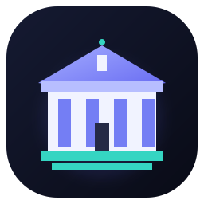
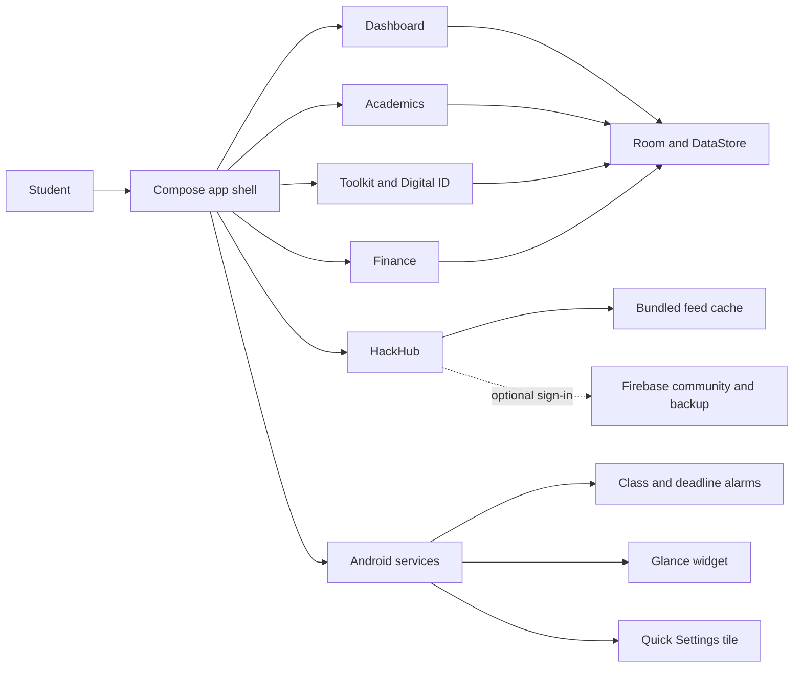

<p align="center">
  
</p>

<h1 align="center">CampusOS</h1>

<p align="center">
  <strong>Your campus life, in one calm command center.</strong><br />
  Academics, focus, money, documents, and campus connections in one Android app.
</p>

<p align="center">
  <a href="https://github.com/Afraz-Dev-Pro/Afraz-CampusOS"></a>
  <a href="https://developer.android.com/"></a>
  <a href="https://kotlinlang.org/"></a>
  <a href="https://developer.android.com/jetpack/compose"></a>
  <a href="https://github.com/Afraz-Dev-Pro/Afraz-CampusOS/actions/workflows/trivy-scan.yml"></a>
</p>

<p align="center">
  <a href="https://github.com/Afraz-Dev-Pro"></a>
  <a href="https://www.linkedin.com/in/afraz-ahamed-94601442b/"></a>
</p>

---

## ✦ A better day starts with a clearer view

CampusOS brings the tools students reach for every day into one thoughtfully designed, offline-first Android experience. See what is next, keep your timetable close, track your progress, and get back to the work that matters.

> **Current build:** v1.1.3 · `com.afraz.campusos` · version code `5`

---

## ✨ What you can do

<table>
  <tr>
    <td width="50%" valign="top">
      <h3>📚 Academics</h3>
      <p>Build a weekly timetable, attach a campus schedule, check attendance, manage tasks, track syllabus progress, estimate grades, and browse past papers.</p>
    </td>
    <td width="50%" valign="top">
      <h3>⌂ Dashboard</h3>
      <p>See your next class, attendance snapshot, urgent deadlines, saved timetable, and shortcuts to the tools you use most.</p>
    </td>
  </tr>
  <tr>
    <td width="50%" valign="top">
      <h3>🧰 Toolkit</h3>
      <p>Scan notes, make PDFs from text, photos, or camera captures, keep campus IDs in a document wallet, and run a focus timer.</p>
    </td>
    <td width="50%" valign="top">
      <h3>💸 Finance</h3>
      <p>Track personal spending, set a monthly budget, split a total by any number of people, or manage friend-by-friend UPI bills.</p>
    </td>
  </tr>
  <tr>
    <td width="50%" valign="top">
      <h3>🚀 HackHub</h3>
      <p>Find project teammates, browse hackathons, and explore cached community feeds with bundled starter data.</p>
    </td>
    <td width="50%" valign="top">
      <h3>📲 Native Android</h3>
      <p>Get class and deadline reminders, a home-screen widget, and a Quick Settings tile for fast scanning.</p>
    </td>
  </tr>
</table>

### Small details, made useful

- **Timetable that travels with you:** add a timetable image or PDF, share a schedule with a QR code, or add course slots manually.
- **Attendance with context:** log present or absent, undo the last entry, and see when you can safely miss or need to attend.
- **Grades with a goal:** calculate SGPA from course grades and estimate the average needed for a target CGPA.
- **Paper to PDF:** select photos or capture several pages in a row, then save them as one PDF.
- **A practical split calculator:** divide a total across a chosen number of people; extra paise are handled so the shares still equal the bill.
- **Private by default:** academic and personal toolkit data stays on device. Sign-in is requested only for community posting or cloud backup.

---

## 🧭 How CampusOS fits together



| Area | Built with |
| :--- | :--- |
| **App UI** | Kotlin, Jetpack Compose, Material 3, Navigation Compose |
| **Local data** | Room, DataStore, Hilt |
| **Community** | Retrofit, OkHttp, Firebase Auth and Firestore |
| **Documents** | Android photo picker, Storage Access Framework, ML Kit Document Scanner |
| **Android features** | AlarmManager, Glance AppWidget, foreground focus service, Quick Settings tile |
| **Build** | Gradle 9.8.1, Android Gradle Plugin 8.7.3, JDK 17 |

---

## 📦 Build CampusOS

### Requirements

- JDK 17
- Android SDK 35
- Android Studio (recommended)

### Build a debug APK

**Windows PowerShell**

```powershell
.\gradlew.bat assembleDebug
```

**macOS / Linux**

```bash
./gradlew assembleDebug
```

The APK is written to `app/build/outputs/apk/debug/app-debug.apk`. This is a **debug build**; create and sign a release build with your own release key before distributing it publicly.

To compile Kotlin without packaging the APK:

```bash
./gradlew compileDebugKotlin
```

---

## ☁️ Optional cloud configuration

Dashboard, academics, toolkit, finance, timetable alarms, and the bundled HackHub feeds work without an account. Cloud features need setup:

1. Create a Firebase Android app for `com.afraz.campusos`.
2. Configure Google sign-in and Firestore.
3. Replace the `CONFIGURE_...` values in [`strings.xml`](app/src/main/res/values/strings.xml), including the Google web client ID.
4. Deploy [`firestore.rules`](firestore.rules).
5. Set the community feed endpoint in [`CommunityFeedApi.kt`](app/src/main/java/com/afraz/campusos/feature_hackhub/CommunityFeedApi.kt) if you publish custom hackathon and PYQ JSON feeds.

Sign-in is requested only when a student chooses to post a teammate request or export a cloud backup. Bundled JSON files provide the HackHub starter feeds when the remote feed is unavailable.

---

## 🗂️ Project map

```text
CampusOS/
├── .github/workflows/             # Trivy filesystem security scan
├── app/src/main/
│   ├── assets/                    # Bundled hackathon and PYQ feed seeds
│   ├── java/com/afraz/campusos/
│   │   ├── core/designsystem/     # Bento Glass colors, theme, and cards
│   │   ├── core/util/             # Attendance, grades, PDF, UPI, QR, and battery helpers
│   │   ├── data/                  # Room entities, DAOs, database, JSON backup
│   │   ├── feature_academics/     # Timetable, attendance, tasks, syllabus, grades
│   │   ├── feature_dashboard/     # Dashboard and About page
│   │   ├── feature_hackhub/       # Teammates, feeds, authentication, backup
│   │   ├── feature_toolkit/       # Scanner, PDF, wallet, finance, focus, widget, tile
│   │   ├── navigation/            # Typed app destinations
│   │   └── di/                    # Hilt database and network providers
│   └── res/                       # Themes, adaptive launcher icon, FileProvider paths
├── gradle/libs.versions.toml      # Central dependency catalog
├── firestore.rules                # Firestore access rules
├── app/build.gradle.kts           # Android app config and dependencies
└── gradlew / gradlew.bat           # Gradle wrappers
```

---

## 🔐 Privacy notes

- Academic records, expenses, wallet documents, and preferences are stored locally by default.
- Cloud backup and teammate posting require an explicit action and Google sign-in.
- The app uses Android's document and photo pickers; it does not request broad storage access or a camera permission.
- Review [`AndroidManifest.xml`](app/src/main/AndroidManifest.xml) and [`firestore.rules`](firestore.rules) for platform permissions and cloud access rules.

---

## 👩‍💻 Built by Afraz Ahamed

<p align="center">
  <a href="https://github.com/Afraz-Dev-Pro"></a>
  &nbsp;
  <a href="https://www.linkedin.com/in/afraz-ahamed-94601442b/"></a>
</p>

<p align="center"><sub>MADE FOR THE EVERYDAY CAMPUS CHAOS · CAMPUSOS</sub></p>
